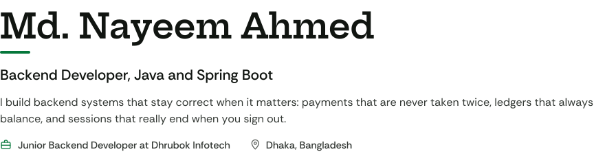
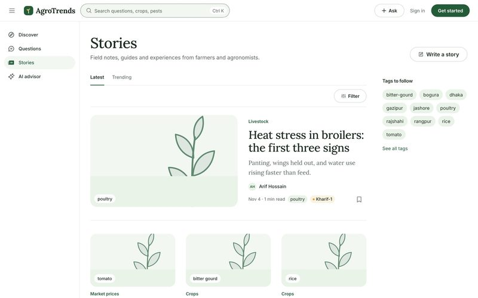
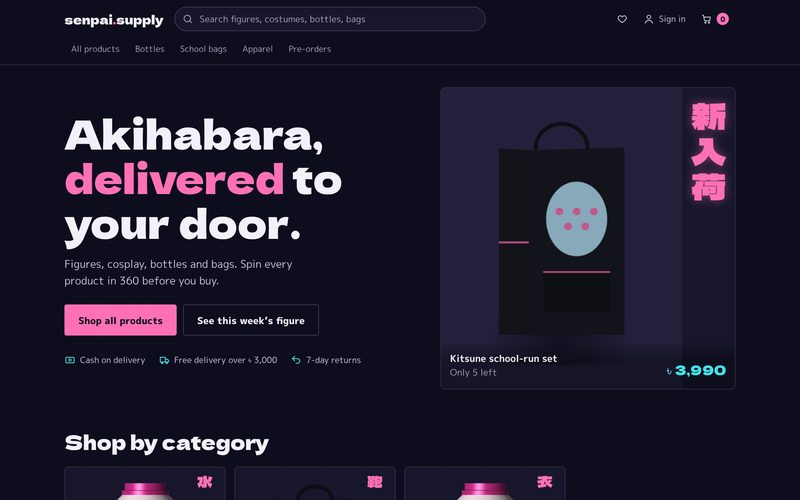
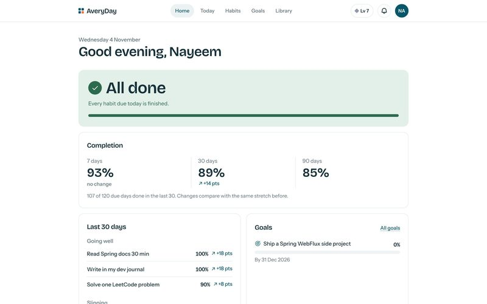
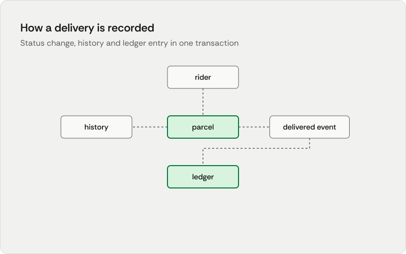
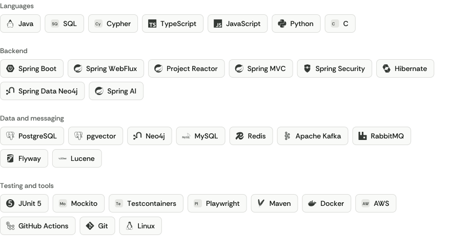

<picture>
  <source media="(prefers-color-scheme: dark)" srcset="assets/header-dark.svg">
  
</picture>

  <a href="https://nayeem-ahmed-portfolio.netlify.app/"><b>Portfolio</b></a> &nbsp;&nbsp;
  <a href="https://www.linkedin.com/in/md-nayeem-ahmed/"><b>LinkedIn</b></a> &nbsp;&nbsp;
  <a href="https://medium.com/@ahmedmdnayeem05"><b>Medium</b></a> &nbsp;&nbsp;
  <a href="https://nayeem-ahmed-portfolio.netlify.app/Nayeem-Ahmed-Resume.pdf"><b>CV</b></a> &nbsp;&nbsp;
  <a href="mailto:ahmedmdnayeem05@gmail.com"><b>ahmedmdnayeem05@gmail.com</b></a>

I work on both sides of Spring: reactive services on WebFlux, Reactor, Neo4j and Kafka at my job, and Spring MVC, JPA and PostgreSQL in my own projects. I plan each project before I build it, keep database changes in versioned migrations, and write tests alongside the code.

## Now

**Junior Backend Developer at Dhrubok Infotech Services Limited**, on TaskATask, a task management platform built with Spring WebFlux and Neo4j.

- Real-time group chat on WebFlux Sinks, with messages encrypted at rest using Jasypt
- Bulk contact import of up to 10,000 records on Redis-backed job queues
- Appointment notifications through Kafka, synced to Google Calendar and iCalendar
- Sign-in with Google, Facebook, Apple and one-time codes over OAuth2

## Projects

Built on my own, from the database to the user interface. Each one has a case study on my portfolio.

<table>
  <tr>
    <td width="50%" valign="top">
      
      <h3>AgroTrends</h3>
      A knowledge-sharing platform for agriculture whose AI advisor answers from the platform's own articles and cites them.  
      Spring Boot · Spring AI · PostgreSQL + pgvector · React  
      <a href="https://nayeem-ahmed-portfolio.netlify.app/projects/agrotrends/">Case study</a> &nbsp;
      <a href="https://github.com/nay-eem-01/AgroTrends">Backend</a> &nbsp;
      <a href="https://github.com/nay-eem-01/agrotrends_web">Frontend</a>
    </td>
    <td width="50%" valign="top">
      
      <h3>Senpai Supply</h3>
      An online store for anime merchandise in Bangladesh, with cash on delivery, bKash and SSLCommerz behind one payment interface.  
      Spring Boot · PostgreSQL · Flyway · React  
      <a href="https://nayeem-ahmed-portfolio.netlify.app/projects/senpai-supply/">Case study</a> &nbsp;
      <a href="https://github.com/nay-eem-01/E-commerce-application-with-springboot">Backend</a> &nbsp;
      <a href="https://github.com/nay-eem-01/ecommerce_web">Frontend</a>
    </td>
  </tr>
  <tr>
    <td width="50%" valign="top">
      
      <h3>AveryDay</h3>
      A habit tracker for self-learners, installable as a phone app. Streaks are calculated from check-ins every time, so they can never drift.  
      Spring Boot 4 · PostgreSQL · Testcontainers · React  
      <a href="https://averyday.vercel.app">Live app</a> &nbsp;
      <a href="https://nayeem-ahmed-portfolio.netlify.app/projects/averyday/">Case study</a> &nbsp;
      <a href="https://github.com/nay-eem-01/habit-tracker">Backend</a> &nbsp;
      <a href="https://github.com/nay-eem-01/habit-tracker_web">Frontend</a>
    </td>
    <td width="50%" valign="top">
      <a href="https://nayeem-ahmed-portfolio.netlify.app/projects/courier/">
        <picture>
          <source media="(prefers-color-scheme: dark)" srcset="assets/courier-dark.svg">
          
        </picture>
      </a>
      <h3>Courier backend</h3>
      Parcel delivery with cash on delivery and merchant payouts. A status change, its history and its ledger entry are saved in one transaction.  
      Spring MVC · JPA · PostgreSQL · Flyway  
      <a href="https://nayeem-ahmed-portfolio.netlify.app/projects/courier/">Case study</a>
    </td>
  </tr>
</table>

## Stack

<picture>
  <source media="(prefers-color-scheme: dark)" srcset="assets/stack-dark.svg">
  
</picture>

## Writing

- [How HashMap Dynamically Resizes in Java](https://medium.com/@ahmedmdnayeem05/how-hashmap-dynamically-resizes-in-java-e4688976b93f)
- [Why Java's Vector Class Is Rarely Used Today](https://medium.com/@ahmedmdnayeem05/why-javas-vector-class-is-rarely-used-today-79ebd2188c50)

## Contact

Open to backend roles, on site or remote. The fastest way to reach me is [ahmedmdnayeem05@gmail.com](mailto:ahmedmdnayeem05@gmail.com).
